# Diagramas e arquitetura

## 1. Por que documentar com diagramas

Uma descrição textual de um fluxo de CI/CD, da arquitetura de um sistema ou da sequência de chamadas entre serviços costuma exigir várias frases para transmitir algo que um diagrama comunica em um único olhar. Diagramas são particularmente úteis para:

- **Fluxos de processo**: a ordem em que etapas acontecem (por exemplo, o caminho entre um `git push` e a publicação final do site).
- **Arquitetura de sistemas**: como componentes se conectam e dependem uns dos outros.
- **Sequências de interação**: a troca de mensagens entre partes (cliente, servidor, banco de dados) ao longo do tempo.

O problema histórico de manter diagramas em uma documentação é que ferramentas de diagramação tradicionais (desenhadas em um editor gráfico separado, exportadas como imagem) tendem a se desatualizar: ninguém reabre o editor original só para mover uma caixa quando o fluxo muda, e a imagem exportada fica desconectada do texto que a cerca.

O [Mermaid](https://mermaid.js.org/) resolve esse problema definindo diagramas como **texto simples**, em uma sintaxe parecida com Markdown, que é interpretada e desenhada no navegador. Como o diagrama é texto, ele vive dentro do próprio arquivo `.md`, junto do conteúdo que ele ilustra, pode ser revisado em um `diff` de Pull Request como qualquer outra mudança de texto, e não exige nenhuma ferramenta externa de edição gráfica.

O Material for MkDocs já inclui a biblioteca JavaScript do Mermaid como parte do próprio tema — não é necessário instalar nenhum pacote Python adicional (como aconteceria com um plugin dedicado); a única coisa necessária é uma pequena configuração do `pymdownx.superfences`, descrita a seguir.

## 2. A configuração `custom_fences`

O trecho relevante do `mkdocs.yml` deste projeto é:

```yaml
markdown_extensions:
  - pymdownx.superfences:
      custom_fences:
        - name: mermaid
          class: mermaid
          format: !!python/name:pymdownx.superfences.fence_code_format
```

Por padrão, a extensão `pymdownx.superfences` trata todo bloco de código cercado por crases (` ``` `) da mesma forma: aplica destaque de sintaxe (*syntax highlighting*) de acordo com a linguagem declarada após as crases de abertura, como visto nos blocos `python`, `yaml` ou `dockerfile` usados em outras páginas deste tutorial.

A opção `custom_fences` ensina o `pymdownx.superfences` a abrir uma exceção para um formato específico. Cada item de `custom_fences` tem três chaves:

- `name: mermaid` — o nome da cerca que recebe tratamento especial; é o texto que aparece depois das três crases de abertura, ou seja, ` ```mermaid `.
- `class: mermaid` — a classe CSS aplicada ao elemento HTML gerado. É essa classe (`mermaid`) que a biblioteca JavaScript do Mermaid, incluída pelo tema Material, procura automaticamente na página para saber quais elementos ela deve processar e renderizar.
- `format: !!python/name:pymdownx.superfences.fence_code_format` — em vez do caminho normal (destacar a sintaxe como código), usa a função `fence_code_format` fornecida pelo próprio `pymdownx.superfences` para envolver o conteúdo bruto do bloco em uma `<div class="mermaid">...</div>`, sem aplicar nenhum destaque de sintaxe a ele.

Juntando as três peças: quando o `mkdocs build` encontra um bloco ` ```mermaid `, ele não tenta colorir a sintaxe como se fosse uma linguagem de programação — ele gera uma `<div class="mermaid">` contendo o texto exato do diagrama. Essa `<div>` chega ao navegador como HTML comum; a biblioteca JavaScript do Mermaid, carregada pelo tema Material em toda página, varre o documento à procura de elementos com a classe `mermaid`, interpreta o texto dentro de cada um deles como uma definição de diagrama e o substitui por um SVG desenhado dinamicamente. Toda essa renderização acontece no navegador do leitor, no momento em que a página é carregada — não durante o `mkdocs build`, que apenas prepara o HTML intermediário.

## 3. Exemplo real: fluxo de CI/CD da documentação

O bloco abaixo não é uma ilustração estática: é um diagrama Mermaid real, processado pela configuração `custom_fences` descrita acima e renderizado como um `flowchart` pelo Documentation_Site no momento em que esta página é carregada no navegador.

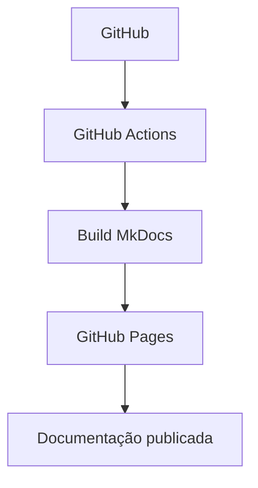

Esse diagrama representa o fluxo de CI/CD de documentação mais comum para um projeto MkDocs hospedado no GitHub:

1. **GitHub**: o repositório onde o conteúdo em Markdown e o `mkdocs.yml` são versionados. Um `git push` para a branch principal é o gatilho de todo o fluxo.
2. **GitHub Actions**: a plataforma de automação do próprio GitHub detecta o push e inicia um workflow configurado no repositório.
3. **Build MkDocs**: dentro do workflow, um passo executa `mkdocs build` (ou `uv run mkdocs build`, no caso deste projeto), convertendo os arquivos `.md` e o `mkdocs.yml` em um site estático (HTML, CSS, JavaScript) na pasta `site/`.
4. **GitHub Pages**: o conteúdo gerado em `site/` é publicado no serviço de hospedagem estática do GitHub, associado ao repositório.
5. **Documentação publicada**: o resultado final, acessível por uma URL pública, é a versão mais recente da documentação, sempre que o fluxo completo é executado com sucesso.

Este diagrama é conceitual: o projeto ainda não possui um workflow de GitHub Actions real configurado (veja a observação sobre o `Repository_Placeholder_URL` na página [Integração com GitHub](integracao-github.md)), mas o fluxo acima descreve a prática padrão para quem deseja publicar este mesmo tipo de projeto automaticamente.

## 4. Construir um fluxograma passo a passo

Um fluxograma Mermaid é composto por três peças: uma declaração do tipo e da direção, nós (as caixas) e conexões (as linhas ou setas). Comece descrevendo o fluxo em poucas etapas e acrescente os detalhes depois.

### 4.1 Declarar o tipo e a direção

A primeira linha indica o tipo do diagrama. Para fluxogramas, use `flowchart`:

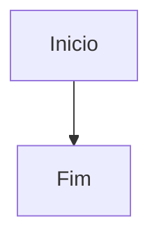

O identificador após `flowchart` define a direção:

| Código | Direção | Quando usar |
|---|---|---|
| `TD` ou `TB` | de cima para baixo | fluxos curtos e etapas em sequência |
| `LR` | da esquerda para a direita | pipelines e sequências horizontais |
| `BT` | de baixo para cima | fluxos em que a base representa o início |
| `RL` | da direita para a esquerda | leitura da direita para a esquerda |

O Mermaid organiza os nós automaticamente. A direção é uma sugestão de layout, não uma posição fixa para cada nó.

### 4.2 Criar nós com identificador e rótulo

Cada nó tem um identificador curto, usado nas conexões, e um rótulo que aparece no desenho. Mantenha os identificadores sem espaços e coloque o texto legível entre os delimitadores:

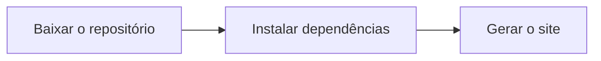

O identificador (`checkout`, `instalar` ou `build`) pode ser reutilizado para ligar o nó a outras etapas. O rótulo entre colchetes pode ter espaços e acentos. Para rótulos com pontuação ambígua, coloque o texto entre aspas, como em `A["Validar pedido (v2)?"]`.

Os delimitadores mais usados mudam o formato do nó:

| Sintaxe | Forma comum | Uso sugerido |
|---|---|---|
| `A["Etapa"]` | retângulo | processo ou atividade |
| `A(Etapa)` | retângulo arredondado | etapa com destaque |
| `A([Início])` | cápsula | início ou fim |
| `A{Aprovado?}` | losango | decisão ou pergunta |
| `A[(Banco de dados)]` | cilindro | banco ou armazenamento |
| `A((Evento))` | círculo | evento ou ponto de conexão |
| `A[[Subprocesso]]` | processo predefinido | rotina detalhada em outro lugar |
| `A[/Entrada e saída/]` | paralelogramo | dados recebidos ou apresentados |
| `A{{Configuração}}` | hexágono | preparação ou configuração |

Veja as formas juntas em um exemplo:

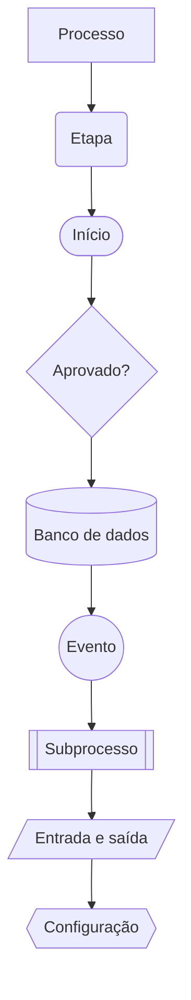

### 4.3 Conectar os nós

Escreva uma conexão entre os identificadores. As formas mais comuns são:

| Sintaxe | Aparência/uso |
|---|---|
| `A --> B` | seta indicando direção |
| `A --- B` | linha sem ponta de seta |
| `A -.-> B` | seta pontilhada, útil para indicar fluxo opcional |
| `A ==> B` | seta mais espessa, para dar ênfase |
| `A <--> B` | conexão com setas nas duas direções |
| `A -->|Sim| B` | seta com rótulo |
| `A -- texto --> B` | outra forma de escrever uma conexão rotulada |

Exemplo dos diferentes tipos de conexão:

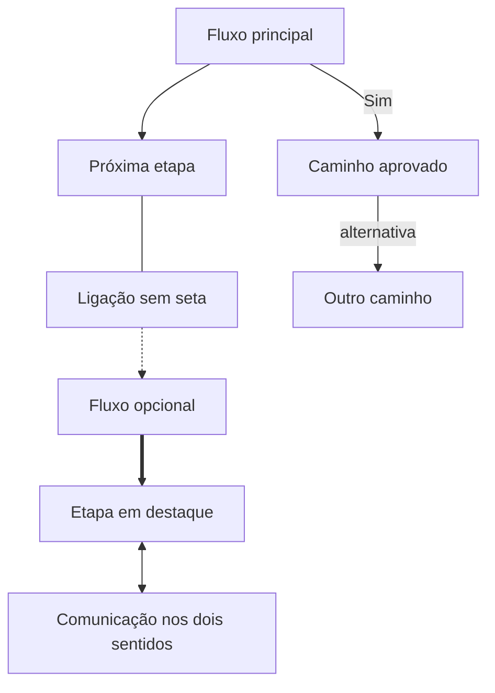

É permitido encadear conexões quando o fluxo é linear:

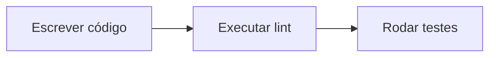

Quando houver uma condição, represente-a com um losango e dê um rótulo a cada caminho:

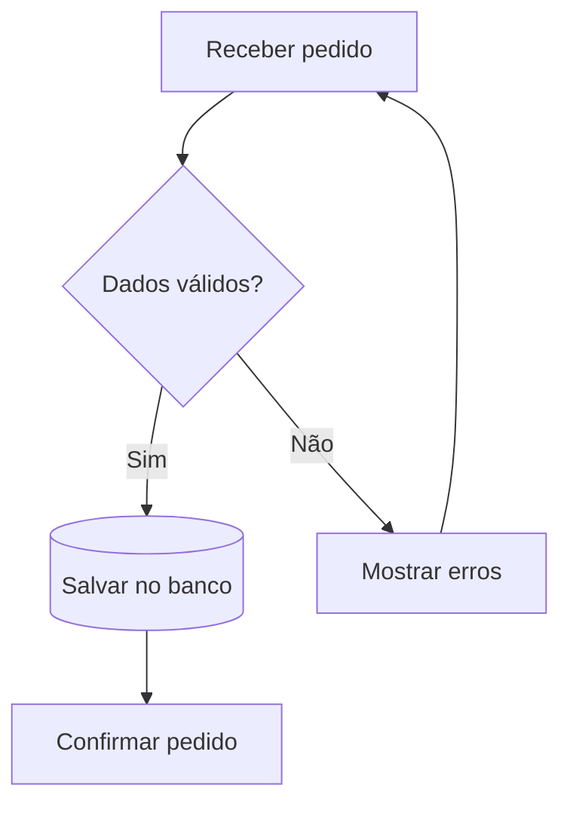

O retorno de `corrigir` para `receber` representa uma repetição do fluxo. Reutilizar o mesmo identificador conecta ao nó existente; criar um novo identificador cria outro nó.

### 4.4 Agrupar etapas relacionadas

`subgraph` desenha um contorno em volta de um grupo de nós. Use um identificador sem espaços e, se desejar, um título entre colchetes:

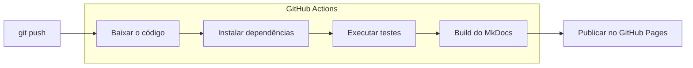

`direction TB` dentro do grupo sugere uma leitura de cima para baixo. Se nós do subgraph também estiverem conectados a nós externos, o Mermaid pode ignorar essa direção local e usar a direção do fluxograma principal. Um subgraph ajuda a separar áreas como navegador, API, banco de dados ou etapas de CI; não é necessário criar um grupo para cada nó.

### 4.5 Montar um diagrama completo a partir dos elementos

Este exemplo reúne início e fim, atividades, uma decisão, rótulos nas setas e um caminho de correção:

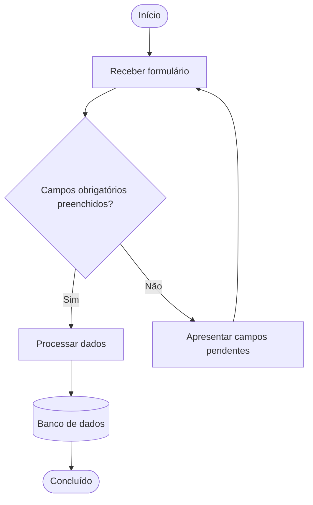

Para criar seu próprio diagrama:

1. Liste as etapas e decisões em linguagem simples.
2. Escolha um tipo que comunique a intenção (por exemplo, retângulo para atividade e losango para decisão).
3. Dê a cada elemento um identificador curto e exclusivo.
4. Conecte-os na ordem do fluxo e nomeie os caminhos de decisão.
5. Execute `uv run mkdocs serve`, abra a página no navegador e ajuste a leitura antes de acrescentar cores ou detalhes.

Evite usar `end` em letras minúsculas como identificador de nó em um fluxograma; essa palavra pode ser interpretada como fechamento de um grupo. Prefira `fim`, `concluido` ou `End`.

## 5. Outros tipos de diagrama

O Mermaid não se limita a fluxogramas. A primeira linha identifica o tipo do diagrama e a sintaxe dos elementos muda de acordo com o que se deseja explicar.

### 5.1 Diagrama de sequência

Mostra quem conversa com quem e em que ordem. `->>` indica uma mensagem e `-->>` costuma representar uma resposta:

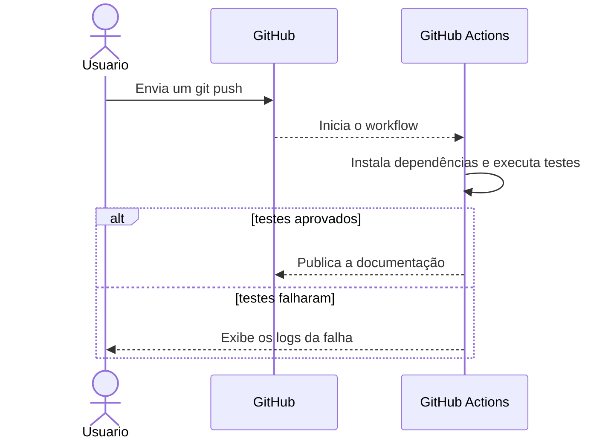

Use `participant` para definir a ordem das colunas, `alt` e `else` para cenários alternativos e `loop` para representar uma repetição. As palavras `end` encerram esses blocos.

### 5.2 Diagrama de classes

Mostra classes, atributos, métodos e relacionamentos:

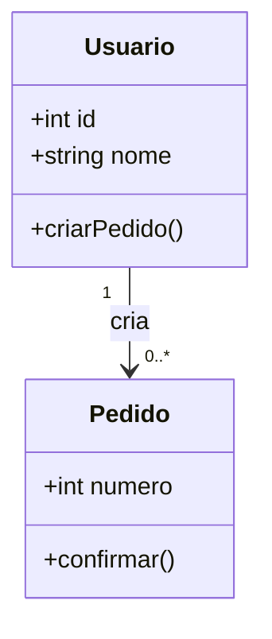

Os sinais antes de um membro indicam visibilidade: `+` público, `-` privado, `#` protegido e `~` pacote. Entre classes, `--|>` representa herança, `*--` composição, `o--` agregação e `-->` associação.

### 5.3 Diagrama entidade-relacionamento

Mostra entidades e cardinalidade das relações, sendo útil para explicar um modelo de dados:

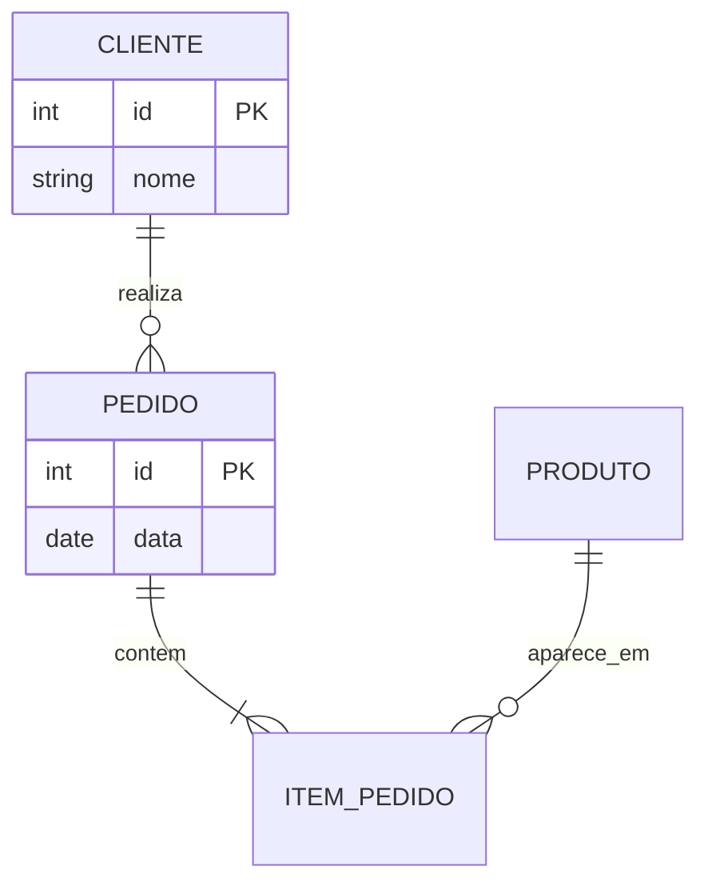

Nos extremos das relações, `||` significa exatamente um, `o|` zero ou um, `|{` um ou mais e `o{` zero ou mais. Por exemplo, `CLIENTE ||--o{ PEDIDO` indica que um cliente pode realizar zero ou vários pedidos.

### 5.4 Diagrama de estados

Representa os estados possíveis de um objeto e as transições entre eles. `[*]` marca o início ou o fim:

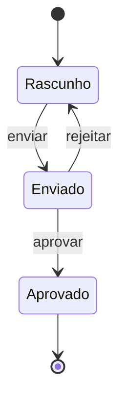

### 5.5 Outros formatos disponíveis

O Mermaid também tem sintaxe para cronogramas (`gantt`), gráficos de pizza (`pie`), histórico de branches (`gitGraph`), mapas mentais (`mindmap`), jornada do usuário (`journey`) e outros tipos. Consulte a [galeria oficial de sintaxes](https://mermaid.js.org/intro/syntax-reference.html) para escolher o formato e ver as regras específicas de cada um.

O Material for MkDocs ajusta automaticamente cores e fontes da paleta do site para fluxogramas, sequências, classes, estados e diagramas entidade-relacionamento. Outros tipos podem renderizar, mas nem todos acompanham automaticamente o tema ou ficam legíveis em telas pequenas.

## 6. Personalizar cores e fontes

### 6.1 Usar as cores e fontes do tema MkDocs Material

Nesta documentação, o tema já define fontes e paletas clara e escura em `mkdocs.yml`; o arquivo `docs/stylesheets/extra.css` define as cores institucionais. O Material aplica essas configurações automaticamente aos tipos de diagrama compatíveis.

Para mudar a identidade visual do site, altere a configuração existente em vez de fixar cores diferentes em cada diagrama. Consulte [Personalização visual](personalizacao.md) para ajustar a paleta, as fontes e o CSS do tema.

### 6.2 Colorir elementos específicos

`classDef` cria uma classe de estilo, `class` associa um ou mais nós a ela, e `linkStyle` altera uma conexão. Cores em hexadecimal ajudam a manter o resultado previsível:

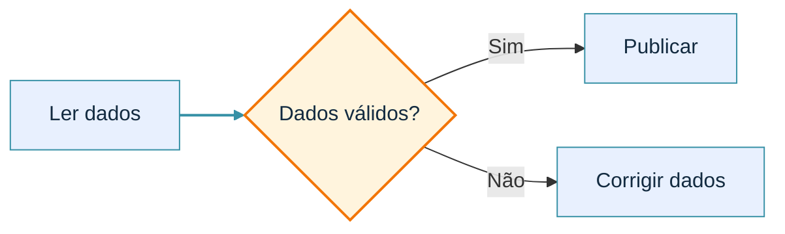

`linkStyle 0` estiliza a primeira conexão declarada; as conexões seguintes são numeradas na ordem em que aparecem. Para um ajuste pontual, também é possível usar `style validar fill:#FFF4DD,stroke:#F27507,color:#132B40`.

Estilos escritos diretamente no diagrama permanecem fixos nos modos claro e escuro. Verifique o contraste nos dois modos e não use apenas a cor para comunicar significado — mantenha rótulos como “Sim”, “Não”, “Erro” ou “Concluído”.

### 6.3 Ajustar o tema e a tipografia de um único diagrama

Em versões atuais do Mermaid, a configuração em frontmatter permite personalizar um diagrama. O tema `base` é o tema destinado a receber variáveis personalizadas:

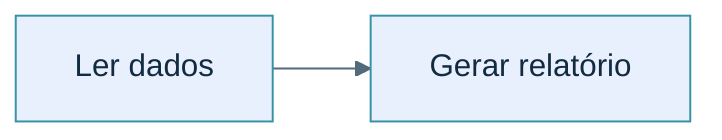

`fontFamily` define a família tipográfica e `fontSize` o tamanho-base. A fonte precisa estar disponível no navegador; inclua alternativas comuns na lista para evitar substituições inesperadas. Para diagramas que não aceitem essa configuração, use a paleta global do Material e estilos `classDef`.

## 7. Ajustar tamanho, espaçamento e legibilidade

O diagrama é desenhado como SVG dentro da largura disponível na página. Quando há muitos nós ou textos longos, o navegador pode reduzir o desenho para fazê-lo caber. Antes de aumentar a fonte globalmente, ajuste o conteúdo e o layout:

- Escolha `LR` para uma sequência horizontal ou `TD` para etapas verticais.
- Reduza textos dentro dos nós; explique detalhes em um parágrafo ao lado.
- Divida processos grandes em diagramas menores e use subgraphs apenas para grupos relevantes.
- Evite cruzar setas; reorganize etapas e diminua conexões redundantes.
- Dê nomes distintos aos identificadores e deixe a direção do fluxo explícita.
- Confira a página em largura de desktop e de celular. O [Mermaid Live Editor](https://mermaid.live/) ajuda a testar a sintaxe, mas faça a conferência final no próprio MkDocs.

Para um fluxograma, o frontmatter também permite ajustar distância entre nós, distância entre níveis, largura para quebra de texto e formato das linhas:

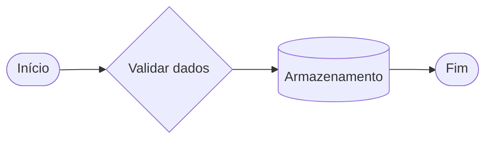

Esses valores são um ponto de partida, não uma regra. Se o diagrama continuar ilegível, divida-o ou mantenha a largura natural com rolagem horizontal.

### 7.1 CSS responsivo opcional

O `mkdocs.yml` deste projeto já carrega `docs/stylesheets/extra.css`. Se os SVGs não se ajustarem bem à página, adicione estas regras ao final desse arquivo:

```css
.md-typeset .mermaid {
  max-width: 100%;
  overflow-x: auto;
}

.md-typeset .mermaid svg {
  display: block;
  max-width: 100%;
  height: auto;
  margin: 0 auto;
}
```

Esse estilo permite que o SVG se adapte à largura do conteúdo. Se um fluxograma muito largo ficar pequeno demais, mantenha `overflow-x: auto` no contêiner e altere `max-width` do SVG para `none`; a página permitirá rolagem horizontal em vez de reduzir o desenho inteiro:

```css
.md-typeset .mermaid svg {
  max-width: none;
}
```

Use essa segunda opção somente quando necessário: ela preserva o tamanho natural do desenho, mas pode exigir rolagem em telas pequenas.

### 7.2 Zoom e movimento interativos com `svg-pan-zoom`

Se a rolagem horizontal não for suficiente, a biblioteca JavaScript [`svg-pan-zoom`](https://github.com/bumbu/svg-pan-zoom) adiciona zoom pela roda do mouse, movimento por arraste e, opcionalmente, controles visuais para ampliar, reduzir e centralizar o SVG. Ela funciona sobre os SVGs que o Mermaid já gera no navegador; não é necessário instalar um plugin Python do MkDocs.

Esta alternativa complementa a rolagem, mas não abre automaticamente um modo de tela cheia. Mantenha uma alternativa responsiva para telas pequenas e confira o resultado nos modos claro e escuro.

#### Passo 1: escolha um diagrama para testar

Este exemplo pode ser copiado para qualquer página Markdown do projeto. Depois da integração, será possível ampliar e arrastar o SVG:

````markdown
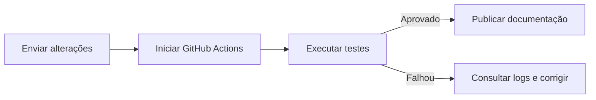
````

#### Passo 2: carregue a biblioteca antes do script de inicialização

No `mkdocs.yml`, acrescente os dois arquivos à lista `extra_javascript`. Preserve os scripts que já existem; a ordem importa: a biblioteca vem antes do script personalizado.

```yaml
extra_javascript:
  - javascripts/mathjax.js
  - https://unpkg.com/mathjax@3/es5/tex-mml-chtml.js
  - https://cdn.jsdelivr.net/npm/svg-pan-zoom@3.6.2/dist/svg-pan-zoom.min.js
  - javascripts/mermaid-panzoom.js
```

O exemplo usa uma versão fixada para evitar atualizações inesperadas. Como a primeira URL depende de uma CDN, o navegador dos leitores precisa acessar a internet. Em redes privadas ou ambientes sem acesso à CDN, baixe a distribuição da versão escolhida para `docs/javascripts/vendor/` e use o caminho local:

```yaml
extra_javascript:
  - javascripts/vendor/svg-pan-zoom.min.js
  - javascripts/mermaid-panzoom.js
```

Ao distribuir uma cópia local da biblioteca, mantenha também os avisos de licença BSD-2-Clause do projeto original.

#### Passo 3: inicialize os SVGs gerados pelo Mermaid

Crie `docs/javascripts/mermaid-panzoom.js` com o conteúdo abaixo. O `MutationObserver` detecta SVGs que o Mermaid renderiza depois do carregamento da página; `document$.subscribe` repete a busca após cada navegação instantânea do Material. Um `WeakSet` evita inicializar o mesmo SVG mais de uma vez.

```javascript
(() => {
  const initializedDiagrams = new WeakSet();
  const diagramSelector = ".md-typeset .mermaid svg";

  function initializeDiagram(svg) {
    if (initializedDiagrams.has(svg)) {
      return;
    }

    window.svgPanZoom(svg, {
      zoomEnabled: true,
      panEnabled: true,
      mouseWheelZoomEnabled: true,
      dblClickZoomEnabled: true,
      controlIconsEnabled: true,
      fit: true,
      center: true,
      minZoom: 0.5,
      maxZoom: 10,
    });

    initializedDiagrams.add(svg);
  }

  function initializeDiagramsIn(node) {
    if (node.nodeType === Node.ELEMENT_NODE && node.matches(diagramSelector)) {
      initializeDiagram(node);
    }

    if (typeof node.querySelectorAll === "function") {
      node.querySelectorAll(diagramSelector).forEach(initializeDiagram);
    }
  }

  const observer = new MutationObserver((mutations) => {
    mutations.forEach((mutation) => {
      mutation.addedNodes.forEach(initializeDiagramsIn);
    });
  });

  observer.observe(document.body, {
    childList: true,
    subtree: true,
  });

  document$.subscribe(() => {
    requestAnimationFrame(() => initializeDiagramsIn(document));
  });

  initializeDiagramsIn(document);
})();
```

Os controles visuais são criados porque `controlIconsEnabled` está habilitado. Para remover os controles e usar apenas roda do mouse, duplo clique e arraste, desative essa opção; para limitar a ampliação, ajuste `minZoom` e `maxZoom`.

#### Passo 4: teste a integração

Execute o site local e teste o diagrama com a roda do mouse, duplo clique, arraste e controles visuais. Navegue para outra página e volte para confirmar que a inicialização continua funcionando com `navigation.instant`.

```powershell
uv run mkdocs serve
```

Se o diagrama não receber os controles, abra o console do navegador e confira se a CDN ou o arquivo local da biblioteca carregou sem erro. Para redes restritas, prefira a cópia local. A biblioteca não transforma o diagrama em texto acessível por si só; descreva o fluxo também em texto e não dependa apenas das cores ou dos controles visuais.

## 8. Erros comuns e diagnóstico

| Sintoma | O que conferir |
|---|---|
| O bloco aparece como código, em vez de diagrama | Use exatamente uma cerca ` ```mermaid ` e confirme `custom_fences` em `mkdocs.yml`. |
| O diagrama não renderiza | Revise a primeira linha (`flowchart`, `sequenceDiagram` etc.), os pares de delimitadores e as setas. |
| Um nó desaparece ou um grupo termina cedo | Evite o identificador `end` em minúsculas e use nomes exclusivos. |
| O SVG fica pequeno | Reduza o número de nós, encurte rótulos, mude a direção ou habilite rolagem horizontal. |
| O zoom/pan não aparece | Confirme que `svg-pan-zoom.min.js` carrega antes de `mermaid-panzoom.js`, que o seletor corresponde aos SVGs e que o console não mostra erros. |
| Cores ficam sem contraste | Confira os modos claro e escuro e prefira a paleta do Material em vez de cores fixas. |
| A página local não mostra a alteração | Deixe `uv run mkdocs serve` ativo e atualize o navegador; confira também o console do navegador se houver erro de sintaxe. |

## 9. Alternativas conceituais: PlantUML e Graphviz

<a id="4-alternativas-conceituais-plantuml-e-graphviz"></a>

O Mermaid cobre bem fluxogramas, diagramas de sequência, de classes e vários outros tipos de diagrama comuns em documentação de software, mas não é a única ferramenta de diagramação como texto que existe no ecossistema. Duas alternativas frequentemente citadas são:

- **[PlantUML](https://plantuml.com/)**: focado especificamente em diagramas UML (casos de uso, sequência, classes, componentes, entre outros), com uma sintaxe própria e, em muitos casos, um nível de detalhe e de conformidade com a notação UML formal maior do que o Mermaid oferece. A limitação prática do PlantUML é que ele não é um interpretador JavaScript executado no navegador como o Mermaid: ele é escrito em Java e depende de um **binário Java** instalado no ambiente que gera a documentação (ou de um serviço externo de renderização) para transformar o texto do diagrama em uma imagem.
- **[Graphviz](https://graphviz.org/)**: focado em grafos genéricos — nós e arestas, com um algoritmo de layout automático particularmente forte para representar relações de dependência, hierarquias e estruturas de árvore. Diferente do PlantUML, o Graphviz não é baseado em Java, mas depende de um **binário externo** próprio, o comando `dot`, que precisa estar instalado no sistema operacional para converter a definição textual do grafo (a linguagem DOT) em uma imagem renderizada.

Nenhuma das duas ferramentas foi instalada neste projeto, e esta seção é apenas uma referência conceitual para o leitor que, em um projeto diferente, precise de um tipo de diagrama que o Mermaid não cobre bem (por exemplo, um diagrama de classes UML mais rigoroso ou um grafo de dependências complexo). A razão para não as adotar aqui é prática: tanto o PlantUML quanto o Graphviz exigiriam a instalação de um binário externo ao ambiente Python (uma máquina virtual Java, no caso do PlantUML, ou o executável `dot`, no caso do Graphviz), o que está fora do escopo de uma dependência instalável simplesmente via `uv add`, como todos os demais plugins deste tutorial. O Mermaid, por não precisar de nada além do JavaScript já embutido no tema Material, continua sendo a opção padrão deste projeto sempre que um diagrama é necessário.

## 10. Referências oficiais

- [Sintaxe dos fluxogramas](https://mermaid.js.org/syntax/flowchart.html)
- [Diagramas de sequência](https://mermaid.js.org/syntax/sequenceDiagram.html)
- [Diagramas de classes](https://mermaid.js.org/syntax/classDiagram.html)
- [Diagramas entidade-relacionamento](https://mermaid.js.org/syntax/entityRelationshipDiagram.html)
- [Diagramas de estados](https://mermaid.js.org/syntax/stateDiagram.html)
- [Temas e variáveis de estilo](https://mermaid.js.org/config/theming.html)
- [Configuração de fluxogramas: espaçamento e layout](https://mermaid.js.org/config/schema-docs/config-defs-flowchart-diagram-config.html)
- [Integração de diagramas no Material for MkDocs](https://squidfunk.github.io/mkdocs-material/reference/diagrams/)
- [JavaScript adicional e navegação instantânea no Material for MkDocs](https://squidfunk.github.io/mkdocs-material/customization/#additional-javascript)
- [Biblioteca `svg-pan-zoom`: instalação, opções e exemplos](https://github.com/bumbu/svg-pan-zoom)
