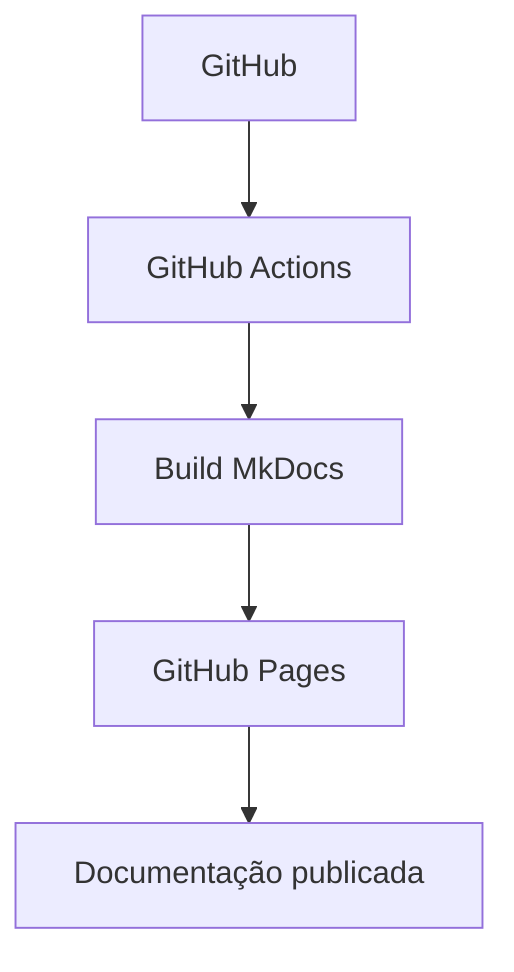

# Diagramas e arquitetura

## 1. Por que documentar com diagramas

Uma descrição textual de um fluxo de CI/CD, da arquitetura de um sistema ou da sequência de chamadas entre serviços costuma exigir várias frases para transmitir algo que um diagrama comunica em um único olhar. Diagramas são particularmente úteis para:

- **Fluxos de processo**: a ordem em que etapas acontecem (por exemplo, o caminho entre um `git push` e a publicação final do site).
- **Arquitetura de sistemas**: como componentes se conectam e dependem uns dos outros.
- **Sequências de interação**: a troca de mensagens entre partes (cliente, servidor, banco de dados) ao longo do tempo.

O problema histórico de manter diagramas em uma documentação é que ferramentas de diagramação tradicionais (desenhadas em um editor gráfico separado, exportadas como imagem) tendem a se desatualizar: ninguém reabre o editor original só para mover uma caixa quando o fluxo muda, e a imagem exportada fica desconectada do texto que a cerca.

O [Mermaid](https://mermaid.js.org/) resolve esse problema definindo diagramas como **texto simples**, em uma sintaxe parecida com Markdown, que é interpretada e desenhada no navegador. Como o diagrama é texto, ele vive dentro do próprio arquivo `.md`, junto do conteúdo que ele ilustra, pode ser revisado em um `diff` de Pull Request como qualquer outra mudança de texto, e não exige nenhuma ferramenta externa de edição gráfica.

O Material for MkDocs já inclui a biblioteca JavaScript do Mermaid como parte do próprio tema — não é necessário instalar nenhum pacote Python adicional (como aconteceria com um plugin dedicado); a única coisa necessária é uma pequena configuração do `pymdownx.superfences`, descrita a seguir.

## 2. A configuração `custom_fences`

O trecho relevante do `mkdocs.yml` deste projeto é:

```yaml
markdown_extensions:
  - pymdownx.superfences:
      custom_fences:
        - name: mermaid
          class: mermaid
          format: !!python/name:pymdownx.superfences.fence_code_format
```

Por padrão, a extensão `pymdownx.superfences` trata todo bloco de código cercado por crases (` ``` `) da mesma forma: aplica destaque de sintaxe (*syntax highlighting*) de acordo com a linguagem declarada após as crases de abertura, como visto nos blocos `python`, `yaml` ou `dockerfile` usados em outras páginas deste tutorial.

A opção `custom_fences` ensina o `pymdownx.superfences` a abrir uma exceção para um formato específico. Cada item de `custom_fences` tem três chaves:

- `name: mermaid` — o nome da cerca que recebe tratamento especial; é o texto que aparece depois das três crases de abertura, ou seja, ` ```mermaid `.
- `class: mermaid` — a classe CSS aplicada ao elemento HTML gerado. É essa classe (`mermaid`) que a biblioteca JavaScript do Mermaid, incluída pelo tema Material, procura automaticamente na página para saber quais elementos ela deve processar e renderizar.
- `format: !!python/name:pymdownx.superfences.fence_code_format` — em vez do caminho normal (destacar a sintaxe como código), usa a função `fence_code_format` fornecida pelo próprio `pymdownx.superfences` para envolver o conteúdo bruto do bloco em uma `<div class="mermaid">...</div>`, sem aplicar nenhum destaque de sintaxe a ele.

Juntando as três peças: quando o `mkdocs build` encontra um bloco ` ```mermaid `, ele não tenta colorir a sintaxe como se fosse uma linguagem de programação — ele gera uma `<div class="mermaid">` contendo o texto exato do diagrama. Essa `<div>` chega ao navegador como HTML comum; a biblioteca JavaScript do Mermaid, carregada pelo tema Material em toda página, varre o documento à procura de elementos com a classe `mermaid`, interpreta o texto dentro de cada um deles como uma definição de diagrama e o substitui por um SVG desenhado dinamicamente. Toda essa renderização acontece no navegador do leitor, no momento em que a página é carregada — não durante o `mkdocs build`, que apenas prepara o HTML intermediário.

## 3. Exemplo real: fluxo de CI/CD da documentação

O bloco abaixo não é uma ilustração estática: é um diagrama Mermaid real, processado pela configuração `custom_fences` descrita acima e renderizado como um `flowchart` pelo Documentation_Site no momento em que esta página é carregada no navegador.



Esse diagrama representa o fluxo de CI/CD de documentação mais comum para um projeto MkDocs hospedado no GitHub:

1. **GitHub**: o repositório onde o conteúdo em Markdown e o `mkdocs.yml` são versionados. Um `git push` para a branch principal é o gatilho de todo o fluxo.
2. **GitHub Actions**: a plataforma de automação do próprio GitHub detecta o push e inicia um workflow configurado no repositório.
3. **Build MkDocs**: dentro do workflow, um passo executa `mkdocs build` (ou `uv run mkdocs build`, no caso deste projeto), convertendo os arquivos `.md` e o `mkdocs.yml` em um site estático (HTML, CSS, JavaScript) na pasta `site/`.
4. **GitHub Pages**: o conteúdo gerado em `site/` é publicado no serviço de hospedagem estática do GitHub, associado ao repositório.
5. **Documentação publicada**: o resultado final, acessível por uma URL pública, é a versão mais recente da documentação, sempre que o fluxo completo é executado com sucesso.

Este diagrama é conceitual: o projeto ainda não possui um workflow de GitHub Actions real configurado (veja a observação sobre o `Repository_Placeholder_URL` na página [Integração com GitHub](integracao-github.md)), mas o fluxo acima descreve a prática padrão para quem deseja publicar este mesmo tipo de projeto automaticamente.

## 4. Alternativas conceituais: PlantUML e Graphviz

O Mermaid cobre bem fluxogramas, diagramas de sequência, de classes e vários outros tipos de diagrama comuns em documentação de software, mas não é a única ferramenta de diagramação como texto que existe no ecossistema. Duas alternativas frequentemente citadas são:

- **[PlantUML](https://plantuml.com/)**: focado especificamente em diagramas UML (casos de uso, sequência, classes, componentes, entre outros), com uma sintaxe própria e, em muitos casos, um nível de detalhe e de conformidade com a notação UML formal maior do que o Mermaid oferece. A limitação prática do PlantUML é que ele não é um interpretador JavaScript executado no navegador como o Mermaid: ele é escrito em Java e depende de um **binário Java** instalado no ambiente que gera a documentação (ou de um serviço externo de renderização) para transformar o texto do diagrama em uma imagem.
- **[Graphviz](https://graphviz.org/)**: focado em grafos genéricos — nós e arestas, com um algoritmo de layout automático particularmente forte para representar relações de dependência, hierarquias e estruturas de árvore. Diferente do PlantUML, o Graphviz não é baseado em Java, mas depende de um **binário externo** próprio, o comando `dot`, que precisa estar instalado no sistema operacional para converter a definição textual do grafo (a linguagem DOT) em uma imagem renderizada.

Nenhuma das duas ferramentas foi instalada neste projeto, e esta seção é apenas uma referência conceitual para o leitor que, em um projeto diferente, precise de um tipo de diagrama que o Mermaid não cobre bem (por exemplo, um diagrama de classes UML mais rigoroso ou um grafo de dependências complexo). A razão para não as adotar aqui é prática: tanto o PlantUML quanto o Graphviz exigiriam a instalação de um binário externo ao ambiente Python (uma máquina virtual Java, no caso do PlantUML, ou o executável `dot`, no caso do Graphviz), o que está fora do escopo de uma dependência instalável simplesmente via `uv add`, como todos os demais plugins deste tutorial. O Mermaid, por não precisar de nada além do JavaScript já embutido no tema Material, continua sendo a opção padrão deste projeto sempre que um diagrama é necessário.
